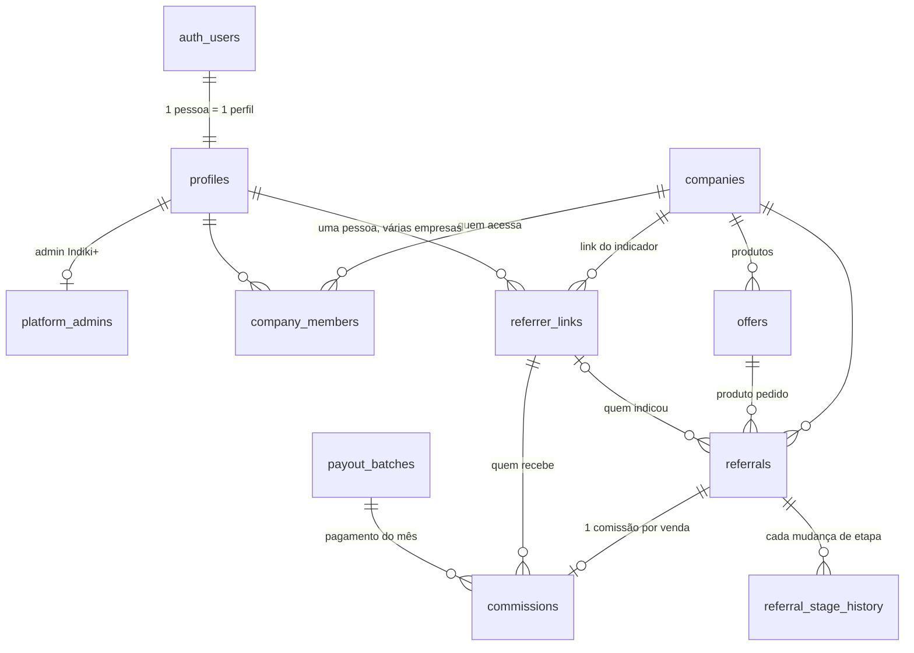

# Banco de dados do Indiki+

Arquivo: `supabase/migrations/20261102000100_core_schema.sql` (pode ser rodada mais de uma vez).
Teste: `supabase/tests/security_smoke.sql` (roda num Postgres de teste, nunca em produção).

## Como as tabelas se ligam

Regras de ligação que o banco garante (chaves compostas, não dá para furar):
- A indicação só aponta para produto **da mesma empresa**.
- O link do indicador na indicação é **da mesma empresa** da indicação.
- A comissão aponta para a indicação e para o link da **mesma empresa**.
- Sem indicador confirmado, a indicação não passa de "orçamento" (não existe comissão sem quem receber).

## Nada se perde

| Proteção | O que faz |
|---|---|
| `ON DELETE RESTRICT` em toda chave estrangeira | Não dá para apagar algo que outra tabela usa |
| Gatilho contra DELETE | Mesmo o dono do banco não apaga empresa, pessoa, indicação nem comissão. "Excluir" = `archived_at` |
| `referral_stage_history` e `audit_log` | Só aceitam inserir. Não alteram nem apagam |
| Campos congelados | Nome/telefone do amigo, consentimento, valor e vínculos da comissão não mudam depois de criados |
| Auditoria | Toda criação e alteração nas tabelas principais guarda antes/depois e quem fez |
| Etapa | Cada mudança vira uma linha do histórico, automaticamente |

## Quem pode o quê

| Papel | Vê | Pode alterar |
|---|---|---|
| Visitante (sem login) | Produtos ativos para o formulário | Só **pedir orçamento** (função com consentimento LGPD) |
| Indicador | Só as **suas** indicações e comissões, com o amigo reduzido ("Carla M."), sem telefone, endereço ou valor da venda | Só **confirmar recebimento** (recebi / não recebi), **aceitar ou recusar** indicação declarada em seu nome, e **sua chave PIX** |
| Empresa (operador) | Só as indicações e comissões **da sua empresa** (sem a chave PIX do indicador) | Só a **etapa** da indicação (uma por vez, e informa o valor da venda ao fechar) |
| Empresa (administrador) | O mesmo | Além da etapa: **cadastra, edita e arquiva seus produtos** e define a comissão (valor fixo ou porcentagem). Mudança vale só para vendas futuras |
| Indiki+ (admin) | Tudo | Libera comissões, fecha o mês, resolve disputas |

Como funciona por baixo: as telas **não escrevem nas tabelas**. O papel logado só tem leitura (filtrada por RLS)
e chama funções que validam a regra: `company_set_referral_stage`, `indicator_respond_commission`,
`indicator_answer_declared`, `indicator_update_payment_info`, `company_save_offer`, `company_archive_offer`, `submit_quote_request`,
`admin_release_due_commissions`, `admin_pay_month`, `admin_resolve_dispute`.

## Ciclo de uma comissão

`pendente` (indicação fechada) → `liberada` (obra instalada e paga + prazo de segurança) →
`paga` (Indiki+ paga no último dia do mês) → `confirmada` (indicador confirma) ou `contestada`
(Indiki+ resolve e volta para `paga`, ou `cancelada`). Indicação perdida cancela a comissão pendente.

## Regra de comissão e contrato (migração 4)
Cada produto define `commission_fixed_cents`, `commission_percent_bps` e, opcionalmente, `commission_cap_cents` (teto).
Comissão = fixo + (percentual × **valor total do contrato**), limitada ao teto (`calc_commission`).
Ao marcar "fechou" a empresa informa **valor e número do contrato** (único por empresa). O valor da comissão fica
congelado; só pode ser corrigido com motivo (`company_correct_sale`) enquanto estiver `pendente`.

## Cadastro de indicadores (migração 3)
A empresa cadastra o indicador (nome, e-mail, telefone) e o sistema gera **código e link**. O amigo pode usar o link/código
ou declarar nome e telefone do indicador (vincula pelo telefone, depois pelo nome único); o indicador precisa confirmar
antes da venda fechar.

## Planos e selos (migração 5) — tudo por parâmetros
| Tabela | O que guarda |
|---|---|
| `plans` | Planos: `inicial`, `intermediario`, `avancado`, `avancado_mais`. Preço (vazio = a definir), taxa, limites (indicadores, produtos, usuários; vazio = ilimitado), nível de relatório, integração CRM, destaque, suporte, `active` |
| `company_plan_history` | Qual plano cada empresa teve e quando, com a taxa daquele momento. Só o fim do período muda |
| `seal_criteria` | O que conta pontos (vendas com contrato, indicadores que confirmaram, contestações, tempo de casa, taxa em dia): peso, teto de pontos, `active` |
| `seal_levels` | Bronze, Prata, Ouro, Platina, Diamante: pontos mínimos, vendas mínimas, `active` (nível desativado é pulado) |
| `company_seals` | Registro do selo ao longo do tempo (só cresce), com "desde quando" |

- **Mudar valores = mudar dados.** O administrador usa `admin_save_plan`, `admin_save_seal_level`, `admin_save_seal_criterion`;
  nada precisa de deploy. Novos critérios exigem uma medição nova em `company_seal_metrics`.
- **Limites travados no banco** (gatilho `enforce_plan_limit`): passar do limite do plano falha mesmo que alguém mexa na tela.
  Rebaixar de plano só é permitido se a empresa já couber no plano menor.
- **Selo é mérito, não se compra.** Recalculado por `admin_recalculate_seals` (agendar diariamente quando houver rotina).
  Verificação pública: visão `public_company_seals` (só nome, nível e desde quando).
- Valores iniciais (pontos, limites, taxas 1% / 0,8% / 0,6% / 0,5%) são **propostas** e podem ser alterados a qualquer momento.

## Grupos de cliente, certificados e ranking (migração 6)
- **Grupos** (`customer_groups`): perfil da empresa (autônomo, pequena, média, grande) com **plano sugerido**. A empresa recebe um grupo
  (`admin_set_company_group`) e a visão `company_group_plan` mostra o plano atual contra o sugerido.
- **Certificados do selo** (`seal_certificates`): quando a empresa tem selo, recebe um certificado com **código público** (`IM-XXXX-XXXX`).
  Subiu ou desceu de nível: o certificado antigo é revogado e um novo é emitido. Validade em `platform_settings` (365 dias).
  Qualquer pessoa confere o código na função pública `verify_certificate` (valido, expirado, revogado, desatualizado, inexistente);
  não existe forma de listar certificados. O selo no site do parceiro carrega dessa verificação.
- **Ranking de indicadores**: `referrer_criteria` (pontos), `referrer_tiers` (níveis, nomes provisórios "Nível 1..5") e
  `referrer_benefits` (benefícios por nível). Pontuação soma todas as empresas em que a pessoa indicou. O indicador vê sua posição e o que
  falta para o próximo nível; o placar geral só mostra o nome de quem **aceitou aparecer** (padrão: anônimo, por causa da LGPD).

## Cobrança, recibos e fiscal (migração 7)
- **Faturas** (`invoices`, `invoice_items`): mensalidade do plano e taxa sobre vendas (uma linha por venda, cobrada uma única vez, com a taxa do
  plano vigente no dia do fechamento). Gerar duas vezes não duplica. Valor e identificação nunca mudam; fatura paga não volta atrás;
  cancelar exige motivo e libera a venda para ser cobrada de novo. Numeração sequencial sem buracos (`F-2026-000001`).
- **Pagamento e recibo**: `admin_record_payment` registra o pagamento (Pix, boleto, cartão, transferência) e **emite o recibo na hora**
  (`R-2026-000001`), com quem pagou, quem recebeu, valor e forma. Recibo e pagamento são somente-inserção. O recibo avisa que **não substitui
  a nota fiscal**; o número da NFS-e é anexado à fatura (`admin_set_fiscal_note`).
- **Quem paga e vê**: a empresa vê suas faturas, recibos e o total pago por ano; o administrador tem o painel `admin_billing_overview`
  (emitido, recebido, em aberto, vencido).
- **Pagamento de comissão** (`commission_payments`): cada comissão paga ao indicador registra bruto, retenções e líquido.
  **Regras de retenção** (`tax_rules`) nascem **desativadas e zeradas**; o contador define as alíquotas.
  A opção `require_cpf_for_payout` (padrão desligada) bloqueia o pagamento de quem não tem CPF cadastrado.
- **Dados fiscais do indicador** (`indicator_tax_profiles`): CPF validado, nome e endereço; só o próprio e o admin veem.
- **Informe de rendimentos** (`income_statements`): por indicador e ano, **versionado** (mudou valor ou CPF, nasce a versão 2 e a 1 fica guardada).
  O indicador vê o seu; a visão `admin_tax_pending` lista quem recebeu mas ainda não tem CPF.

### Fluxo do dinheiro (migração 8) — como no PDF
1. A empresa fecha a venda e a comissão fica **liberada** (obra instalada + carência).
2. O Indiki+ gera as faturas: **taxa do plano sobre a venda** (receita do Indiki+) e **repasse de comissões** (dinheiro de passagem,
   não é receita). A taxa é cobrada **por cima** da comissão: a empresa paga comissão cheia + taxa; o indicador recebe a comissão cheia.
3. A empresa paga; o administrador confirma e o **recibo** sai na hora.
4. No fechamento do mês, `admin_pay_month` paga o indicador **somente das comissões cujo repasse já foi pago**
   (opção `require_repasse_before_payout`, ligada). As demais ficam liberadas, e o indicador vê "aguardando o repasse da empresa".
5. Cada pagamento registra bruto, retenções e líquido; o **Indiki+ é a fonte pagadora** (retém, emite o informe e informa a Receita).
- `admin_pending_repasse`: quanto está esperando repasse por empresa. `admin_billing_overview`: receita separada do repasse.
- O critério de selo "faturas pagas em dia" agora tem medição (fica desativado até você ligar).

### O que o banco NÃO resolve (precisa de contador e advogado)
Emissão de nota fiscal de serviço; alíquotas reais de IRRF e INSS (o imposto de renda usa tabela progressiva mensal); dados da empresa
emissora (razão social e CNPJ ficam em `platform_settings`); envio mensal das informações à Receita (a DIRF acabou em 2025; hoje é
eSocial e EFD-Reinf); como o Indiki+ recebe das empresas e paga os indicadores, ele é a fonte pagadora e o enquadramento disso (inclusive o tratamento do repasse, que não é receita) deve ser confirmado com o contador antes de cobrar.

## Taxa do Indiki+
Percentual do **plano vigente no dia em que a venda fechou** (`company_plan_history`), aplicado ao valor total das vendas
fechadas. Mudar de plano não altera vendas passadas. A visão `company_platform_fees` calcula o total.

## Decisões tomadas
- **Um único ambiente de banco** (Supabase `indiquemais`), compartilhado por teste, homologação e produção. Como os três usam os mesmos dados, os dados de teste ficam misturados com os reais: usar empresas e indicadores de teste claramente marcados e limpar (arquivar) antes de operar com clientes reais.
- **A empresa cadastra os próprios produtos e a regra de comissão** (fixa, % do contrato ou os dois, com teto opcional). Trava de segurança: porcentagem acima de 50% exige validação com o Indiki+.

## Decisões em aberto
1. **Dados pessoais (LGPD):** o telefone do amigo fica também no log de auditoria, visível só ao admin. Falta a rotina de anonimização a pedido do titular.
2. **Quem é o primeiro administrador da plataforma** (cadastrar em `platform_admins`).

## Migração 9: regra de comissão congelada na indicação

- A empresa pode editar a comissão do produto a qualquer momento. A mudança vale só para indicações **criadas depois**.
- Cada mudança de regra do produto gera uma linha em `offer_rule_versions` (só cresce; gatilho no próprio `offers`, então vale até para o SQL Editor).
- `referrals.rule_*` guarda a regra (fixo, %, teto, carência) no instante em que a indicação nasce. Um gatilho bloqueia qualquer alteração dessas colunas.
- Fechar venda e corrigir o valor do contrato calculam pela regra da indicação (`calc_commission_ref`), nunca pela regra atual do produto. A carência de liberação também vem da indicação.
- Exceção: `admin_correct_referral_rule` (só admin do Indiki+, motivo obrigatório, só antes de a comissão ser liberada, com auditoria `CORRECAO_REGRA`).
- Tela da empresa lê `company_offer_rule_history` (versões, quantas indicações cada uma tem e quantas estão em andamento).
- Testes: `supabase/tests/rule_snapshot.sql`.

## Migração 10: convite da empresa e cadastro completo do indicador

- `company_invites`: um link por empresa (`/convite/CÓDIGO`). A empresa copia, pausa/reativa ou renova (o antigo morre; quem já entrou continua vinculado). Funções `company_invite_get/set_active/rotate`.
- `invite_info(token)` é público e devolve só o nome da empresa e se o link vale.
- `indicator_register(...)`: exige e-mail confirmado; valida nome completo, telefone, 18+ anos, cidade/UF, CPF, PIX (por tipo) e aceite dos termos; grava perfil + CPF (`indicator_tax_profiles`) e cria o vínculo (`referrer_links`) com o código na empresa. Adota um cadastro prévio feito pela empresa (mesmo e-mail ou telefone) em vez de duplicar. CPF em branco mantém o já cadastrado (entrar em outra empresa).
- `indicator_my_profile`: o próprio cadastro, com CPF mascarado.
- Testes: `supabase/tests/indicator_signup.sql`.

## Migração 11: painel da empresa

- `companies` ganha telefone, e-mails (contato e financeiro), site e endereço. `company_update_profile` (só admin da empresa ou do Indiki+); razão social e CNPJ só o Indiki+ altera.
- Visões: `company_my_companies` (empresas que a pessoa acessa e o papel), `company_indicators` (agora com origem convite/manual, cadastro completo e vendas; sem CPF/PIX), `company_offers` (produtos com indicações, vendas e em andamento).
- `referral_link_info(code)` público: empresa, primeiro nome de quem indicou e produtos ativos (sem valores de comissão), para a página `/i/CÓDIGO`.
- Testes: `supabase/tests/company_panel.sql`.

## Migração 12: empresas e acessos pelo admin

- `admin_create_company` e `admin_update_company_legal` (CNPJ validado com dígitos, `is_valid_cnpj`), plano no cadastro.
- `company_grant_access(empresa, e-mail, papel)`: e-mail com conta vira membro na hora; sem conta gera convite de acesso (`company_member_invites`, link `/acesso/TOKEN`, 14 dias, só para aquele e-mail). Admin do Indiki+ e admin da empresa podem usar.
- `accept_access_invite`, `access_invite_info` (público), `company_revoke_access` (nunca o último admin; registra `REMOVE_ACESSO` na auditoria), `company_set_member_role`, `company_cancel_access_invite`.
- `company_members` deixa de ser "nunca apagar": o vínculo é removido só pelas funções acima.
- Visões `company_team` (membros + convites pendentes) e `admin_companies`. Corrige `company_my_companies` (lia o plano por uma função sem permissão).
- Testes: `supabase/tests/company_access.sql`.

## Migração 13: painel do admin

- Visões só para o admin do Indiki+ (vazias para qualquer outra pessoa): `admin_overview` (totais, funil por etapa, dinheiro), `admin_company_summary` (comparação por empresa), `admin_indicators` (todas as empresas; CPF mascarado, PIX completo porque o Indiki+ paga; comissões a liberar/liberadas/pagas), `admin_offers`, `admin_referrals` (indicações e vendas com a comissão), `admin_commissions`.
- Testes: `supabase/tests/admin_views.sql`.

## Migração 14: pedidos de cadastro e vitrine

- Empresas: `submit_company_signup` (público, CNPJ validado, um pedido pendente por CNPJ) grava em `company_signup_requests`. `admin_decide_company_signup` aprova (cria a empresa no plano escolhido e libera o acesso do responsável pelo e-mail do pedido) ou recusa. Visões `admin_company_signups` e `admin_pending`.
- Vitrine: `companies.listing_mode` (`fechado` só convite; `aprovacao` padrão, pedido fica pendente; `aberto` entra na hora) e `public_description`; `company_set_listing`; `public_companies()` público.
- Indicador pelo site: `indicator_request_company` (exige cadastro completo; adota cadastro prévio da empresa; reabre pedido recusado). `referrer_links.request_status` (`pendente`/`aprovado`/`recusado`) — pendente/recusado nunca ativo. Empresa decide com `company_decide_indicator_request` (recusado é arquivado, com motivo). Indicador acompanha em `indicator_my_companies`.
- Testes: `supabase/tests/signup_requests.sql`.

## Migração 15: PIX na hora de receber e painéis

- `indicator_register`: CPF continua obrigatório (evita cadastro duplicado); chave PIX opcional e, se vier vazia, mantém a que já existe. `indicator_set_pix` para cadastrar/trocar depois.
- Gatilho `trg_commission_requires_pix`: comissão não vira "paga" sem chave PIX do indicador.
- `referral_link_info` devolve `company_phone` (botão "Falar com a empresa" depois do pedido).
- `indicator_my_referrals` (indicações do indicador com a comissão; sem valor da venda). `company_referrals` passa a trazer a regra congelada e a data de liberação.
- Testes: `supabase/tests/pix_panel.sql`.

## Migração 16: empresa registra indicação recebida por fora

- `company_register_referral(empresa, produto, cliente, telefone, indicador, autorização do cliente, observação)`: para o cliente que procurou a empresa direto e disse quem indicou. Qualquer membro da empresa registra; o indicador é escolhido na lista dela (ativo e aceito). Nasce como `declarado`, ligado ao indicador, e só pode ser fechada depois que ele confirmar no painel (`indicator_answer_declared`). Recusa telefone de cliente que já tem indicação em andamento. Registro vai para a auditoria (`REGISTRO_EMPRESA`).
- Testes: `supabase/tests/register_referral.sql`.

## Migração 17: indicação repetida vira alerta

- `company_register_referral` deixa de recusar cliente com indicação em andamento: o mesmo cliente pode ter mais de uma (outra compra). A tela de Indicações marca "possível duplicada" quando há outra aberta com o mesmo telefone e oferece "É duplicada: encerrar esta" (vira perdida com a nota "Indicação duplicada").

## 1800 — Planos iguais aos do site piloto
- Os 3 planos à venda viram **Mensal** (R$ 397, sem fidelidade, 1% sobre vendas), **Semestral** (R$ 297/mês, 6 meses, 0,8%) e **Anual** (R$ 197/mês, 12 meses, 0,6%). Códigos mantidos (`inicial`, `intermediario`, `avancado`).
- Todos com o mesmo acesso: indicadores e produtos sem limite, até 5 usuários, relatório completo.
- Nova coluna `plans.commitment_months` (fidelidade em meses).
- `avancado_mais` desativado: reservado para um plano extra. Quem já está nele continua.
- A página inicial lê os planos do banco (`lib/planos.ts`): mudou preço ou taxa no banco, o site atualiza em minutos.
