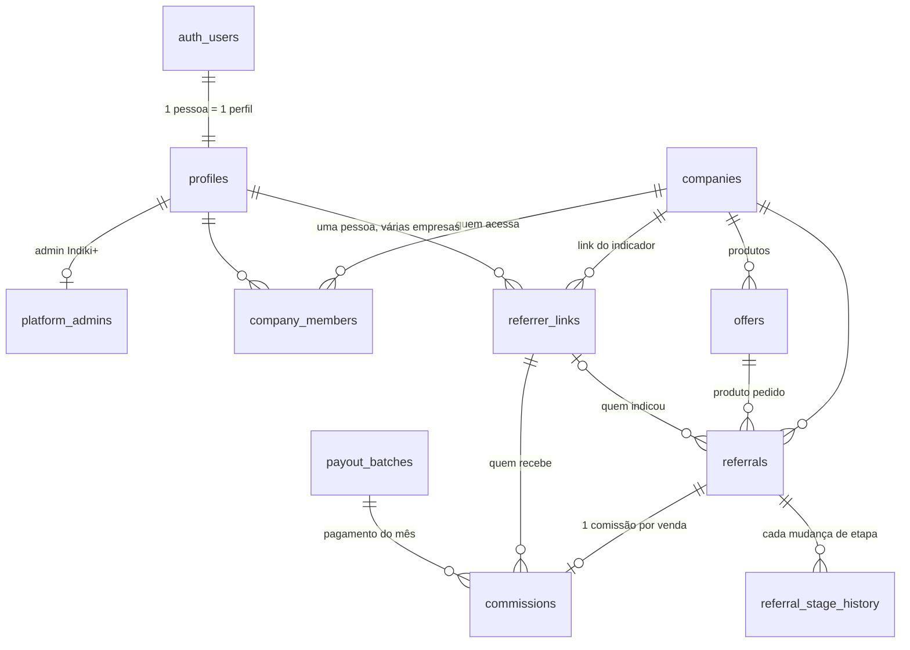

# Banco de dados do Indiki+

Arquivo: `supabase/migrations/20261102000100_core_schema.sql` (pode ser rodada mais de uma vez).
Teste: `supabase/tests/security_smoke.sql` (roda num Postgres de teste, nunca em produção).

## Como as tabelas se ligam

Regras de ligação que o banco garante (chaves compostas, não dá para furar):
- A indicação só aponta para produto **da mesma empresa**.
- O link do indicador na indicação é **da mesma empresa** da indicação.
- A comissão aponta para a indicação e para o link da **mesma empresa**.
- Sem indicador confirmado, a indicação não passa de "orçamento" (não existe comissão sem quem receber).

## Nada se perde

| Proteção | O que faz |
|---|---|
| `ON DELETE RESTRICT` em toda chave estrangeira | Não dá para apagar algo que outra tabela usa |
| Gatilho contra DELETE | Mesmo o dono do banco não apaga empresa, pessoa, indicação nem comissão. "Excluir" = `archived_at` |
| `referral_stage_history` e `audit_log` | Só aceitam inserir. Não alteram nem apagam |
| Campos congelados | Nome/telefone do amigo, consentimento, valor e vínculos da comissão não mudam depois de criados |
| Auditoria | Toda criação e alteração nas tabelas principais guarda antes/depois e quem fez |
| Etapa | Cada mudança vira uma linha do histórico, automaticamente |

## Quem pode o quê

| Papel | Vê | Pode alterar |
|---|---|---|
| Visitante (sem login) | Produtos ativos para o formulário | Só **pedir orçamento** (função com consentimento LGPD) |
| Indicador | Só as **suas** indicações e comissões, com o amigo reduzido ("Carla M."), sem telefone, endereço ou valor da venda | Só **confirmar recebimento** (recebi / não recebi), **aceitar ou recusar** indicação declarada em seu nome, e **sua chave PIX** |
| Empresa (operador) | Só as indicações e comissões **da sua empresa** (sem a chave PIX do indicador) | Só a **etapa** da indicação (uma por vez, e informa o valor da venda ao fechar) |
| Empresa (administrador) | O mesmo | Além da etapa: **cadastra, edita e arquiva seus produtos** e define a comissão (valor fixo ou porcentagem). Mudança vale só para vendas futuras |
| Indiki+ (admin) | Tudo | Libera comissões, fecha o mês, resolve disputas |

Como funciona por baixo: as telas **não escrevem nas tabelas**. O papel logado só tem leitura (filtrada por RLS)
e chama funções que validam a regra: `company_set_referral_stage`, `indicator_respond_commission`,
`indicator_answer_declared`, `indicator_update_payment_info`, `company_save_offer`, `company_archive_offer`, `submit_quote_request`,
`admin_release_due_commissions`, `admin_pay_month`, `admin_resolve_dispute`.

## Ciclo de uma comissão

`pendente` (indicação fechada) → `liberada` (obra instalada e paga + prazo de segurança) →
`paga` (Indiki+ paga no último dia do mês) → `confirmada` (indicador confirma) ou `contestada`
(Indiki+ resolve e volta para `paga`, ou `cancelada`). Indicação perdida cancela a comissão pendente.

## Taxa do Indiki+
`companies.platform_fee_bps` (100 = 1%) sobre o valor das vendas já fechadas. Por isso o valor da venda
é obrigatório ao marcar "fechou". A visão `company_platform_fees` calcula o total.

## Decisões tomadas
- **Um único ambiente de banco** (Supabase `indiquemais`), compartilhado por teste, homologação e produção. Como os três usam os mesmos dados, os dados de teste ficam misturados com os reais: usar empresas e indicadores de teste claramente marcados e limpar (arquivar) antes de operar com clientes reais.
- **A empresa cadastra os próprios produtos e a regra de comissão** (fixa em reais ou porcentagem). Trava de segurança: porcentagem acima de 50% exige validação com o Indiki+.

## Decisões em aberto
1. **Dados pessoais (LGPD):** o telefone do amigo fica também no log de auditoria, visível só ao admin. Falta a rotina de anonimização a pedido do titular.
2. **Quem é o primeiro administrador da plataforma** (cadastrar em `platform_admins`).
